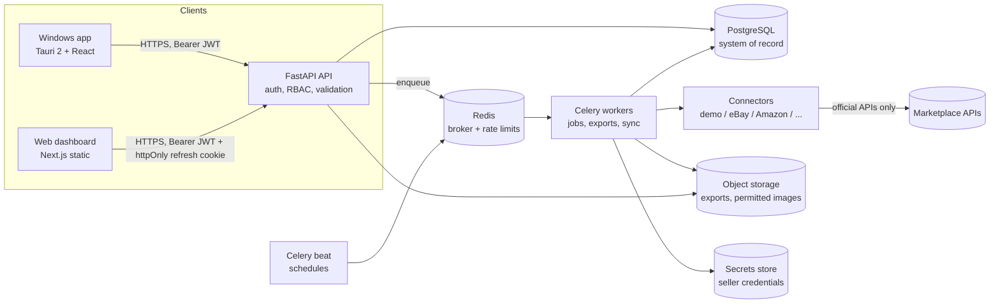
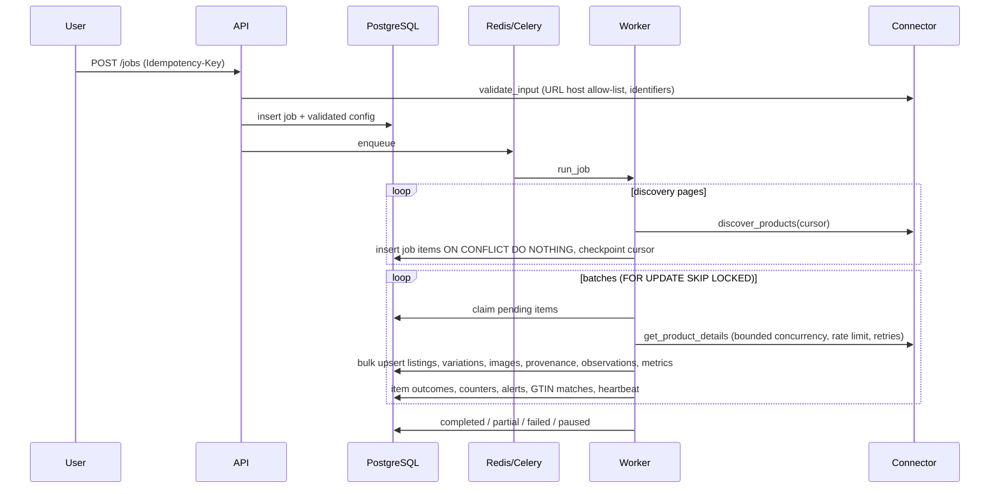
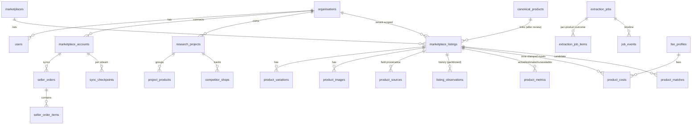

# Architecture

## Logical architecture

* The desktop and web clients share **one UI build**: Next.js is exported to static
  files, served by the web host and bundled by Tauri. Desktop-only features
  (keychain, native downloads and notifications) go through `web/lib/desktop.ts`, and
  each one is a no-op in the browser.
* Neither client connects to the database. Background jobs run in the cloud and
  keep running after the Windows app is closed.
* Connector credentials live in the secrets store. SQL holds only `credential_reference`.

## Extraction pipeline

Reliability properties:

* Every discovered ID is stored before enrichment. The discovery cursor is checkpointed per page.
* Item claiming uses `SKIP LOCKED`. Items left in `processing` by a crashed worker are
  released on restart. The `recover_stale_jobs` task requeues jobs whose heartbeat stopped.
* Transient errors retry with full-jitter exponential backoff and honour `Retry-After`.
  A circuit breaker stops calls to a source that keeps failing. Items that keep failing
  become `failed` (the dead-letter set) and can be retried with *Resume*.
* Authentication or permission errors **pause** the job instead of failing it. Fix access, then resume.
* No database transaction is held open across a remote API call.

## Data model

The schema is owned by SQL migrations (`backend/migrations/sql`). Key decisions:

| Decision | Why |
|---|---|
| Listings are scoped to an organisation (`UNIQUE (organisation_id, marketplace_id, external_listing_id)`) | Own-account data can never leak between tenants. Research is attributable. |
| Canonical products are separate from listings | One product, many listings, each with independent price, stock, images and variations. |
| `listing_observations` is partitioned by month and append-only | Hundreds of millions of rows. Old months can be detached or archived. |
| Observations are written only on change, plus at most one per day | Keeps history dense where it matters and small where it doesn't. |
| `product_metrics.measurement_type` uses a CHECK so `unavailable` means `numeric_value IS NULL` | Zero can never stand in for unknown. |
| Money is `NUMERIC(14,4)` and always carries its currency | No float rounding, and no amount without a currency. |
| `product_costs` is append-only with `effective_from` | Historical profit calculations stay reproducible. |
| `mv_listing_summary` materialised view | Dashboards for large organisations read pre-aggregated data. |

## Indexing for a million or more records

* Keyset pagination with row-value comparisons `(column, id) > (:v, :id)`, served by
  `(organisation_id, column, id)` indexes. Deep pages cost the same as the first page.
* A generated `tsvector` column with GIN (full-text), plus trigram GIN on title and category.
* A partial index on pending job items, and a partial index for refresh scheduling.
